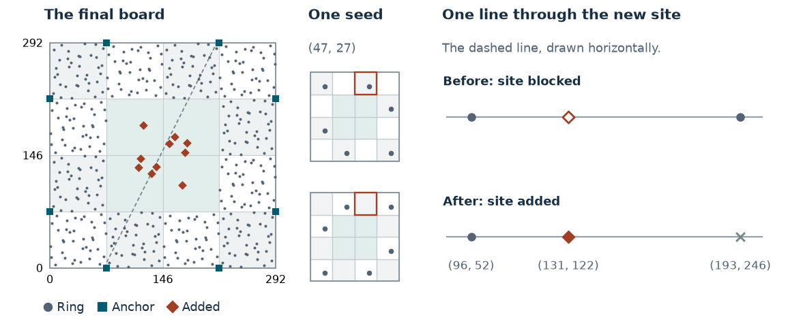

# No3InLine

**A super-polylogarithmic excess in the no-three-in-line problem**  
Dmitry Kamenetsky · R4 working preprint · arXiv submission package prepared

**[Read the paper (PDF)](paper/main.pdf)** · [TeX and ancillary source](paper/arxiv-source.tar.gz) · [arXiv fields and abstract](paper/arxiv-submission.md) · [Standalone finite replay (ZIP)](paper/anc/no3-replay-r2.zip) · [Response to the latest review](REVIEW-RESPONSE.md) · [Two-tier comparisons (CSV)](results/checked-comparisons.csv) · [Verification transcripts](verification/) · [Source credits](THIRD_PARTY.md)

On a square of side `n`, let `F_ht(n)` be the maximum number of points with no three on an ordinary straight line, invariant under the half-turn about the board centre. The paper proves that for infinitely many primes `p ≡ 1 (mod 840)`, with `n = 4p + 1`,

> **F_ht(n) ≥ 3n/2 + 1/2 + exp(log p / (114 log log p)).**

This **super-polylogarithmic excess** dominates every fixed power of `log n`, but is smaller than every positive power of `n`. This refines the **additive term on a subsequence**; it does not improve the classical all-sides leading coefficient, bound the actual excess from above, or establish a positive density of good sides. Hall–Jackson–Sudbery–Wild's native side is `2q` for prime `q`, not `4p+1`. If confirmed, this would be, to our knowledge, the first guarantee of growing additive excess over `3n/2` along an infinite sequence, more than fifty years after their 1975 construction. The explicit sufficient range in §§7–8 is not a practical cutoff.

### The construction in one example

The [opening two pages](paper/main.pdf) follow a single board before introducing the formal proof. Think of the board as four rows of four tiles. A seed dot has twelve copies around the outside after we leave the four central tiles empty. We keep six copies per seed. A **flip** trades six for six for each seed in a linked group: it changes which lines are blocked, but not the number of ring points.



On this board the ring has 432 points and the eight anchors bring the count to 440. Initially `(131,122)` would be the third point on a line. One flip clears the site without shrinking the ring. Inserting that point and its half-turn partner gives 442; five pairs fit **together**, giving 450. The small example explains the construction; the later proof shows why a growing collection of pairs can share one arrangement on infinitely many boards. [Continue to the switches and matching](paper/FIGURES.md).

**R4 (`review-r4`).** The denominator improves from **300 to 114**; the ring construction, 15 finite witness counts and leading coefficient do not change. The theorem now has a direct link from the example and a bookmark at §1.1. A separate check from the pinned K/S source archives confirms Table 1. [Changelog](CHANGELOG.md) · [Response and outstanding proof questions](REVIEW-RESPONSE.md) · [ArXiv submission sheet](paper/arxiv-submission.md).

**R3 baseline.** Lemma 3.1 displays the normalized character expansion and the correction at its shift roots. Sections 5–7 make the counting multiplicities, edge cases and powers of `L_p` explicit. Appendix A contains the finite examples; the four F† comparisons are reported-only. The project data did not change: the [commit-pinned finite kit](https://raw.githubusercontent.com/dimkadimon/No3InLine/e19b8a1b689eba392c7d26ec3733e88db566dc0e/paper/anc/no3-replay-r2.zip) has SHA-256 `238f38e60234b982cd0ba13045bfad4809fb00e764d0eb1278bfeb7378d6d9ca`. It is available separately, in the source tarball's `anc/` directory and in the reader PDF. The tagged R3 release is a working manuscript, not a journal publication or arXiv submission.

## Selected finite bounds

All project counts below are verified. The **checked benchmark** is the strongest C/R (analytic) or K/S (coordinate-backed) comparison in the stated source set. The last column is different: it records a stronger **forum report**, transferred to the same side, whose source coordinates were not checked. The [CSV](results/checked-comparisons.csv) gives all 15 sides, both differences, and the separate excess over `3n/2`.

| Side | Project witness | Checked benchmark | Stronger report only (difference from witness, `W−B_F`) |
|---:|---:|---:|:---|
| 293 | 508 (quarter-turn) | 504 · K | 512 (−4) |
| 389 | 668 (quarter-turn) | 576 · C/R | 652 (+16) |
| 773 | 1,188 (half-turn) | 1,152 · R | 1,244 (−56) |
| 4,037 | 6,296 (half-turn) | 6,048 · C/R | 6,118 (+178) |
| 10,085 | 15,520 (half-turn) | 15,120 · R | — |
| 16,018 | 24,588 | 24,306 · S | — |
| 32,002 | 48,838 | 48,421 · S | — |
| 64,006 | 97,062 | 96,816 · S | — |

A positive comparison is **not a world-record claim**. See [the definitions and provenance](results/README.md). The 4,782,972-point example on side 3,188,645 realizes the matching criterion with 144 clauses, 288 distinct endpoint cosets and 38 component flips; it is not a numerical test of the asymptotic cutoff.

## Reproduce the release

Use Python 3.9+ **without `-O`**, and a C++17 compiler (`c++` by default). The principal geometry and table checks use no network, solver or nonstandard Python packages. The **standalone ZIP**, which is also attached to the reader PDF, has its own README and manifest; these same offline checks run in an empty directory after unpacking it. On a typical workstation allow several minutes and several hundred MB of RAM, especially for the largest matching example.

```sh
python3 scripts/verify_release.py --hashes-only   # release integrity, seconds
python3 scripts/comparison.py                    # historical report-inclusive kit table
python3 scripts/review_tables.py                 # current tables: checked and report-only
python3 paper/anc/check-scales.py                # finite arithmetic, incl. Phi_840(3) certificates
python3 scripts/verify_release.py                # all 15 manuscript witnesses, exact geometry
python3 scripts/audit_counting.py                # small exact diagnostics, not an asymptotic proof
python3 scripts/build_paper.py                   # needs TeX, qpdf, Poppler; full checkout, not the kit
```

The witness verifier reconstructs sets independently of the heuristic that found them. It compares released CSVs with compact certificates or exact digests, checks the actual geometric constraints, and reproduces the matching certificate byte-for-byte. `verification/r4-witnesses.txt` records the R4 replay from a clean extraction of that kit. These checks do **not** verify the asymptotic estimates by computer.

For the separately credited upstream comparisons and the older experimental packages:

```sh
python3 scripts/restore_inputs.py --fetch         # 159 pinned data files; see THIRD_PARTY.md
python3 scripts/comparison.py --audit-sources    # all 146 P22 input geometries and exact crop maxima
python3 scripts/check_public_frames.py           # recheck the three published P47 starting sets
python3 scripts/recheck_benchmarks.py .cache/upstream  # second K/S pass from raw ZIPs (NumPy)
python3 scripts/verify_release.py --expand-large # also create two optional 131074-/1000018-side CSVs
python3 studies/improvements/verify.py --rescan  # earlier all-board/axis rescans and finite-branch audits
python3 studies/larger-grids/verify.py           # earlier frame, deletion/cover, medium-board and gap checks
```

`restore_inputs.py` refuses unpinned source bytes. It can also work offline from the named, previously downloaded archives. Do not commit restored third-party files or the two regenerable large CSVs. Previous package READMEs describe the original standalone bundles; their manifests remain unchanged. On this checkout, restore their inputs first. The new proof, all of its finite certificates and the 15 project lower bounds are already checkable before that step.

## Where to look

| Path | Contents |
|:---|:---|
| `paper/` | Current named preprint, complete proof, four vector illustrations, bibliography, reader PDF and TeX-source archive with ancillary kit. |
| `results/` | Machine-readable comparison, exact crop results, source row indices, and reported benchmarks. |
| `unbounded-gain/` | Original working proof and the C++ matching builder, separate verifier and compact certificate. |
| `small-prime-examples/` | Six anchored rings and a credited catalogue control. Download/open `gallery.html` to inspect the actual points offline. |
| `studies/improvements/` | Best exchange/rotation sets, exact coordinate lists, frame edits, all-side generator and interactive `explore.html`. |
| `studies/followup/`, `studies/general-grids/` | Earlier anchored-ring and boundary/interpolation notes, generators, and frozen-ring certificates. |
| `studies/larger-grids/`, `studies/no3research/` | Earlier larger frames and separate full-square-symmetry census, with source, certificates, and independent checkers. |
| `scripts/`, `verification/` | Release-level replay/build scripts and actual run summaries. |

## Attribution and license

Dmitry Kamenetsky proposed this research. Responsibility for the manuscript rests with the named author. Proof development, implementation, search and writing were substantially AI-assisted. The project has no assigned arXiv identifier in this release. Please cite the title and the Git revision or tagged version used. The earlier working notes are retained to document provenance, not as separate claims of refereed publication.

The [MIT License](LICENSE) covers original project work. Upstream coordinate sources, inferred benchmarks, prior theorems, catalogue words/control sets, and font subsets are separately credited in [THIRD_PARTY.md](THIRD_PARTY.md); no third-party license is being overwritten. For the maintainer's safe GitHub publication workflow see [PUBLISH.md](PUBLISH.md).
