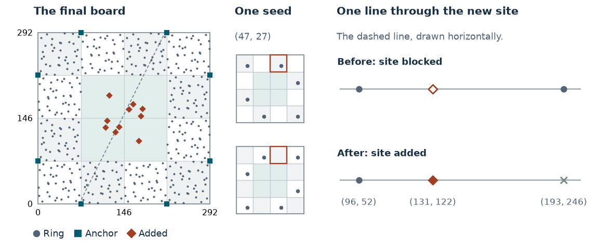
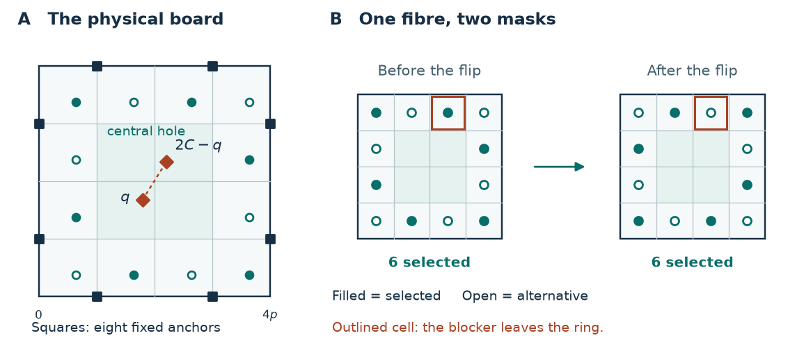
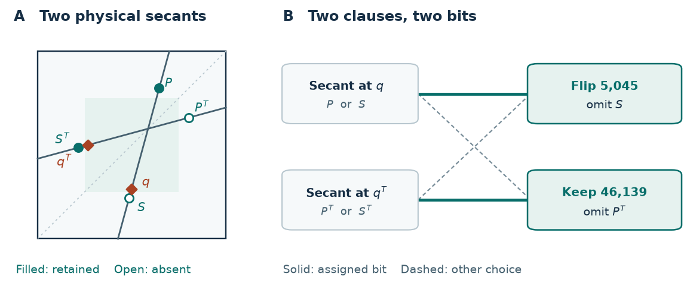
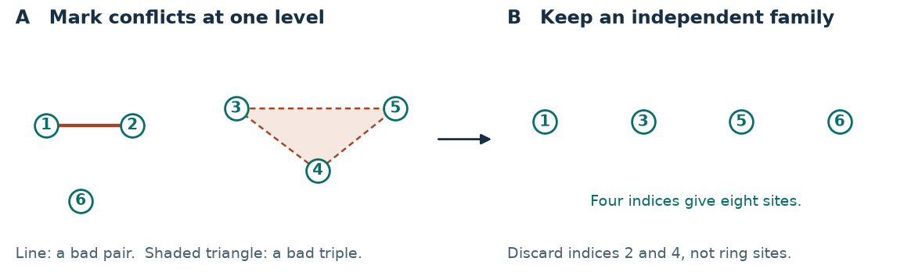

# How the construction works

## 1. A site can be empty but blocked

On the 293 × 293 board the outer twelve tiles hold six copies of each of 72 seed dots. Two fixed anchors on each edge bring the total to **432 + 8 = 440**. The two small boards show just one seed before and after the group flip. Count the dots: six in each picture, but the outlined tile changes from occupied to vacant. On the right the open diamond is blocked at first because it would be the third point on an ordinary straight line. A flip vacates `(193,246)` but replaces the affected ring sites elsewhere. The ring still has 432 points. Now `(131,122)` and its opposite partner `(161,170)` can be added for a total of **442**. The shown arrangement actually admits five opposite pairs, giving **450** points. [Vector figure](figures/one-flip.pdf).

## 2. Why changing the ring costs no points

The eight squares sit on the boundary. The ring leaves the middle block free; proposed insertions come in half-turn pairs there. On the left, only the lifts of one residue pair, `(47,27)` at `p=73, k=28`, are shown. On the right, the outlined cell changes from filled to empty. It contains `(193,246)`, one of two ring points that initially block the proposal `(131,122)` on the line `y = 2x − 140`. Flipping the entire component clears this endpoint without reducing the number of ring points. The other ring fibres are omitted, **not** empty. [Vector diagram](figures/ring-and-masks.pdf) · [Complete 450-point finite example](figures/one-flip.pdf)

## 3. Match blocking pairs to orientation bits

This is a fragment of the actual side-3,188,645 witness, not a generic cartoon. At `q=(1591070,845785)`, the two old endpoints are `P=q+155653(3,11)` and `S=q−14051(3,11)`. The other representative is the transpose of `q`, so its endpoints are the transposes of `P` and `S`. A clause asks that at least one of its endpoints be absent. The matching assigns one bit to each clause:

| Assigned bit | Choice | Endpoint absent as a result |
|---:|---|---|
| 5,045 | Flip the whole component | `S` at `q` |
| 46,139 | Keep the original orientation | `Pᵀ` at `qᵀ` |

The four endpoint occurrences have different abscissa cosets. Transposition exchanges the two cosets of a bit, so only two bits appear. The half-turn mates of the two targets are **different from the transpose** and are protected by reflection. In the full certificate, 144 clauses are matched and 38 bits are flipped. [Vector diagram](figures/matched-secants.pdf) · [Exact coordinates and bit labels](../results/diagram-endpoints.csv)

## 4. Thin the proposals, not the ring

Every numbered vertex represents **two** proposed sites at the same level. Here one pair and one triple of indices are marked as incompatible. Discarding indices 2 and 4 removes both obstructions; the four survivors supply eight sites once their clauses are matched. This is a schematic of the deletion argument in Proposition 7.2, not a numerical sample or an estimate of the asymptotic gain. [Vector diagram](figures/shared-level-selection.pdf)

From the repository root, run `python3 scripts/figure.py` to verify the stages of the opening example and redraw its figure; run `python3 scripts/construction_diagrams.py --previews paper/figures/previews` to regenerate the other three figures and the four-row endpoint CSV (redrawing requires Matplotlib). The TeX archive already contains the vector PDFs and needs no graphics-generation software.
